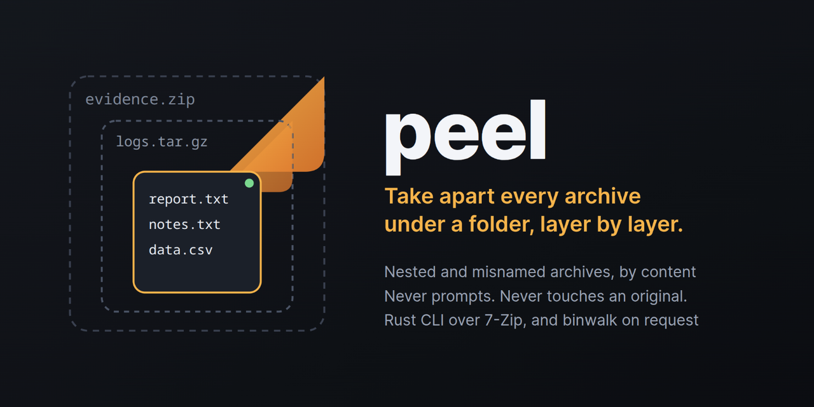

# peel



A folder of downloads, exported evidence, firmware dumps or malware samples rarely holds its content in plain sight. It sits inside archives, often inside other archives. Some are misnamed or carry no extension at all, some want a password, and one of them might be a zip bomb. Unpacking that by hand is a loop of `7z x`, `cd`, repeat, and each round can prompt, overwrite, or fill the disk.

peel does the loop for you. Point it at a folder and it opens every archive it finds, beside the original, then opens whatever came out of those, until nothing new appears. It never prompts, never touches an original, and leaves nothing half-written behind.

```console
$ peel .
extracted  ./attachment -> ./attachment_x  [zip]
extracted  ./evidence.zip -> ./evidence  [zip]
extracted  ./attachment_x/logs.tar.gz -> ./attachment_x/logs  [tar+gzip]
extracted  ./evidence/logs.tar.gz -> ./evidence/logs  [tar+gzip]
locked     ./mail/sample.7z
peel: 4 extracted (0 carved), 0 already done, 1 locked, 0 too big, 0 too deep, 0 failed in 0.0s

$ peel -p infected .
extracted  ./mail/sample.7z -> ./mail/sample  [7z]
peel: 1 extracted (0 carved), 4 already done, 0 locked, 0 too big, 0 too deep, 0 failed in 0.0s
```

Here `attachment` is a zip with no extension, and `logs.tar.gz` sits inside both zips. The second run opens only the password-protected sample, because everything else is already done.

## How it works

peel walks the tree without following symlinks and asks 7-Zip what each file is, by content rather than by extension. Anything 7-Zip can open is extracted into `<stem>/` beside it: `foo.zip` becomes `foo/`, and `a.tar.gz` becomes `a/` holding the files, with no leftover `.tar`. When that name is taken, the output goes to `foo.zip_x/`. Whatever comes out is walked again, up to a depth cap (8 by default). With `-b`, files 7-Zip cannot open also go to binwalk, which carves out what it recognizes. binwalk only sees the top layer, meaning the paths you give and every file loose under them, so a PDF that came out of a zip keeps its images. `--binwalk-depth N` lets carving reach N layers down, never past `--depth`, and it turns on `-b` by itself. A loose PDF at the top is still carved.

- **Originals are never changed.** Each extraction runs in a hidden work directory that peel creates itself and renames into place only on success. A failed, locked, oversized or interrupted extraction leaves nothing behind.
- **Nothing prompts.** 7-Zip always gets a password (a dummy one unless you pass `-p`) and a closed stdin, so a locked archive is named in the summary and skipped.
- **Re-runs only do new work.** Each output folder records which archive made it, as a `user.peel.src` extended attribute (or a small `.peel-src` file on filesystems without xattrs). A folder that lacks that record is never mistaken for done.
- **A 10 GiB cap per extraction is on by default** (`-m 0` turns it off). Archives that list a bigger size are skipped up front, and a watchdog stops any extraction whose output passes the cap, which also catches compressed streams that lie about their size. The watchdog checks at least every 250 ms, so output can pass the cap briefly before it stops. With `-j N`, up to N extractions run at once and each gets its own cap. To bound a whole run, against a zip bomb for example, use `--total-size`, which is off by default.
- **Opt-in limits:** `--max-files N` and `--timeout 10m` per extraction, and `--total-size 100G` for the whole run. With `--strict`, the exit status is 1 when anything was left unopened.
- **Leftovers of a run that died hard** (SIGKILL, OOM, power loss) are removed on the next run. Only folders peel itself marked as its own work are removed. Anything else at a name peel reserves is reported and left alone. The mark is a user extended attribute, so on a filesystem without user xattrs a leftover is reported and left alone too.

The exit status is 0 when all is well and 1 when an archive failed to open (corrupt, or no backend could read it) or a path you gave doesn't exist. It is 2 for a usage error or a missing backend, and 130 for Ctrl-C or another stop signal. Locked, too big, too deep, timed-out, unreadable and skipped items are reported but keep the status at 0 unless you pass `--strict`.

## Install

peel runs on Linux. It needs Rust 1.88 or newer to build, installed with [rustup](https://rustup.rs), and 7-Zip at run time. Distribution rustc packages are often older than 1.88 and will refuse to build it.

```sh
git clone https://github.com/r3cursive/peel-cli peel && cd peel
cargo install --path . --locked     # installs ~/.cargo/bin/peel
peel --help
```

| Backend | Found as | Notes |
|---|---|---|
| 7-Zip | `$PEEL_7Z`, else `7zz`, else `7z` on PATH | Required. Some distribution builds leave out RAR support; the upstream `7zz` from 7-zip.org has it. Builds older than 26.01 work too. |
| binwalk 3 | `$PEEL_BINWALK`, else `binwalk` on PATH | Optional, used only with `-b` or `--binwalk-depth`. Many of its extractors call further tools (sasquatch, jefferson, ubireader, cabextract, lz4, lzop), and a missing one only means that format is not carved. |

Only absolute PATH entries are searched, and every child process gets a PATH of absolute entries only (or no PATH, when yours has no absolute entry), so a `7zz` planted in the tree being peeled is never run.

## Usage

```sh
peel .                        # everything under the current folder
peel ~/cases/x some.zip       # any mix of folders and single files
peel -p infected samples/     # try a password on encrypted archives
peel -b firmware/             # also carve files 7-Zip cannot open (top layer)
peel --binwalk-depth 3 fw/    # carve inside extracted output too, 3 layers down
peel -n .                     # dry run: list what would be opened
peel -- *                     # after --, every argument is a path, even one named like an option
peel --timeout 10m --total-size 50G --strict incoming/
```

A bare `peel` with no path prints a hint and exits 2 without touching anything. A dry run writes nothing into the tree. With `-b`, though, it still runs binwalk on each file 7-Zip rejects, in a private scratch directory under `$TMPDIR`, to see whether anything would be carved. Run `peel --help` for every option.

## Scripts and agents

peel never prompts, and it prints no colour or progress, so a pipe gets what a terminal gets. Every program it runs gets an empty stdin.

- Preview a run with `peel -n PATH`. It writes nothing into the tree.
- `-q` keeps stdout to problems. The summary line always goes to stderr.
- In the summary, `N extracted (M carved)` counts the carves inside N. The timed out, unreadable, skipped and leftovers-removed counts appear only when they aren't zero.
- `--timeout` bounds one extraction. To bound a whole run, use `timeout 1h peel PATH`. peel stops cleanly on SIGTERM, and `timeout` then exits 124.

To tell an agent about peel, a line like this in its CLAUDE.md or AGENTS.md is enough:

> `peel` unpacks every archive under a path, beside the original. Run `peel --help` first, always give a path (`peel .`), and preview with `peel -n`.

## Safety

peel never follows a symlink while walking, and never writes outside the folder that holds each input. Its work directories carry 64 random bits in their names and are created exclusively, so nothing planted in the tree can redirect an extractor. File names in its output have control and bidi characters escaped. A stop signal kills every running extractor and probe, helpers included.

What lands inside an output folder is the extractor's work. Since 25.01, 7-Zip drops `..` and absolute path parts, and skips symlinks that point outside the output unless `-snld` is passed, which peel never does. binwalk's built-in extractors keep their writes inside the output folder, and its external helpers are on their own. Builds older than 25.01 lack those symlink protections, so use 7-Zip 25.01 or newer on anything untrusted. None of this has been tested against deliberately hostile archives. For untrusted samples, run peel inside a VM or container.

peel itself makes no network connections.

To report a vulnerability, see [SECURITY.md](SECURITY.md).

## Development

```sh
cargo test                                  # unit and end-to-end tests
cargo test --test cli wildcard_names_are_literal
cargo clippy --all-targets -- -D warnings
cargo fmt --check
```

The end-to-end tests build their fixtures with `7z`, `tar`, `gzip`, `bzip2`, `xz`, `zstd` and `setfattr`, so those must be on PATH. The 7-Zip build must read zstd, and `setfattr` comes from the `attr` package. The binwalk tests skip themselves when binwalk is missing. `CLAUDE.md` describes the architecture and the invariants the tests enforce.

## License

MIT. See [LICENSE](LICENSE).
